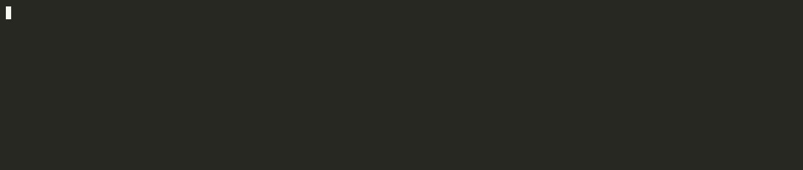

# libnmap

Build & leverage [nmap](https://github.com/nmap/nmap) as a node.js module, no need to install an `nmap` binary.

[](https://npmjs.com/package/libnmap) [](https://github.com/jas-/node-libnmap/actions/workflows/ci.yml)  [](https://snyk.io/test/github/jas-/node-libnmap?targetFile=package.json)

## install ##



To install `npm install libnmap`

The install gets the nmap and OpenSSL sources and compiles them. See `build tools` for details.

Some package managers (pnpm, yarn, bun, and npm with `ignore-scripts`) do not
run install scripts unless you allow them. If a scan gives the error "the nmap
module is not compiled", allow the install script of `libnmap` and run
`npm rebuild libnmap`.

### build tools ###

Example package requirements.

<details>
<summary>Debian, Ubuntu (apt)</summary>

```sh
sudo apt-get install build-essential perl python3 nodejs npm
```
</details>

<details>
<summary>Fedora, RHEL, CentOS, Rocky, AlmaLinux (dnf)</summary>

```sh
sudo dnf install gcc gcc-c++ make perl python3 diffutils tar nodejs npm
```
</details>

<details>
<summary>openSUSE (zypper)</summary>

```sh
sudo zypper install gcc gcc-c++ make perl python3 nodejs npm
```
</details>

<details>
<summary>Arch Linux, Manjaro (pacman)</summary>

```sh
sudo pacman -S --needed base-devel perl python nodejs npm
```
</details>

<details>
<summary>Gentoo (emerge)</summary>

```sh
sudo emerge --ask dev-lang/perl dev-lang/python net-libs/nodejs
```

The compiler and `make` are part of the base system.
</details>

<details>
<summary>Alpine (apk)</summary>

```sh
sudo apk add build-base linux-headers perl python3 nodejs npm
```
</details>

<details>
<summary>macOS</summary>

```sh
xcode-select --install
brew install node
```

The Xcode command line tools supply the compiler, `make`, `perl` and `python3`.
</details>

## methods ##

* `scan`      Scans the ports of each host in the range
* `discover`  Finds the neighbors on the IPv4 network of each network interface

## options ##

* `range`     {Array}     Hostnames, IPv4/IPv6 addresses, CIDR or address ranges
* `ports`     {String}    Ports to scan (default `1-1024`)
* `timeout`   {Number}    Number of seconds to wait for each host (default `120`)
* `flags`     {Array}     More nmap flags (default `-T4`)
* `udp`       {Boolean}   Scan UDP ports (requires root)
* `json`      {Boolean}   JSON object as output (default), false produces XML

## examples ##

More examples are in the `examples/` folder.

### scan ###


```javascript
const nmap = require('libnmap');
const opts = {
  range: [
    'scanme.nmap.org',
    '10.0.2.0/25',
    '192.168.10.80-120',
    'fe80::42:acff:fe11:fd4e/64'
  ],
  ports: '22,80,443'
};

nmap.scan(opts, function(err, report) {
  if (err) throw err;

  console.log(JSON.stringify(report, null, 2));
});
```

### discover ###


```javascript
const nmap = require('libnmap');

nmap.discover(function(err, report) {
  if (err) throw err;

  console.log(JSON.stringify(report, null, 2));
});
```

## tests ##

To test `npm test`

## license ##

This software is licensed under the [Nmap Public Source License](https://nmap.org/npsl/), the same license as nmap. See [LICENSE](https://github.com/jas-/node-libnmap/blob/master/LICENSE).

Copyright Jason Gerfen, 2013.
